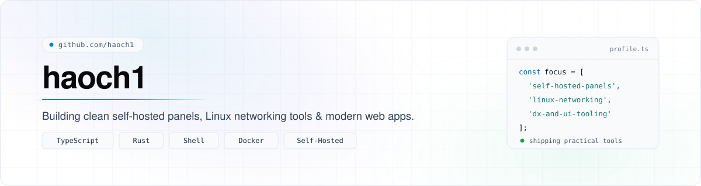

  <a href="https://github.com/haoch1">
    <picture>
      <source media="(prefers-color-scheme: dark)" srcset="./assets/banner-dark.svg" />
      <source media="(prefers-color-scheme: light)" srcset="./assets/banner-light.svg" />
      
    </picture>
  </a>

  

    <a href="./README.md">简体中文</a> · <strong>English</strong>
  

  

    Building <strong>self-hosted cloud panels</strong>, <strong>Linux networking tools</strong>, and <strong>modern full-stack apps</strong>. 
    Focused on clean UX, minimal dependencies, and effortless Docker / single-binary deployments.
  

  

    
    
    
  

---

### Featured Projects

<table>
  <tr>
    <td width="50%" valign="top">
      <a href="https://github.com/haoch1/CloudSeed"><strong>CloudSeed</strong></a> 
      Self-hosted Cloudflare DNS &amp; R2 management panel with multi-account support and one-command Docker deployment.  
      <code>TypeScript</code> <code>Cloudflare</code> <code>Docker</code>
    </td>
    <td width="50%" valign="top">
      <a href="https://github.com/haoch1/lightsail-panel"><strong>lightsail-panel</strong></a> 
      Self-hosted Amazon Lightsail console with multi-account/multi-region control, Web SSH, traffic charts &amp; auto-shutdown.  
      <code>JavaScript</code> <code>AWS Lightsail</code> <code>Web SSH</code>
    </td>
  </tr>
  <tr>
    <td width="50%" valign="top">
      <a href="https://github.com/haoch1/aliyun-panel"><strong>aliyun-panel</strong></a> 
      Self-hosted Alibaba Cloud ECS panel with keep-alive, traffic threshold guard, scheduled power &amp; Telegram alerts.  
      <code>TypeScript</code> <code>Docker</code> <code>Alibaba Cloud</code>
    </td>
    <td width="50%" valign="top">
      <a href="https://github.com/haoch1/hproxy"><strong>hproxy</strong></a> 
      Proxy node &amp; port-forwarding control plane for Linux servers using a Docker controller and native binary agent (sing-box + Realm).  
      <code>Rust</code> <code>Docker</code> <code>Linux</code>
    </td>
  </tr>
  <tr>
    <td width="50%" valign="top">
      <a href="https://github.com/haoch1/forme"><strong>forme</strong></a> 
      Chinese-first shadcn/ui workbench with presets, live component preview, theme editor &amp; standalone project templates.  
      <code>React</code> <code>TypeScript</code> <code>Vite</code> <code>Tailwind</code>
    </td>
    <td width="50%" valign="top">
      <a href="https://github.com/haoch1/SeekFeed"><strong>SeekFeed</strong></a> 
      Self-hosted NodeSeek monitoring &amp; analytics platform with RSS ingestion, trending feeds, keyword alerts &amp; Telegram bot.  
      <code>Bun</code> <code>Hono</code> <code>SQLite</code> <code>TypeScript</code>
    </td>
  </tr>
</table>

---

### Recently Updated

Auto-synced daily via GitHub Actions

<!-- RECENT_PROJECTS:START -->
- [**SeekFeed**](https://github.com/haoch1/SeekFeed) · `TypeScript` · 2026/11/26 面向 NodeSeek 社区的轻量级自托管监控与分析平台，提供 RSS 实时采集、关键词订阅、Telegram 通知与多维统计分析，基于 Bun、Hono 与 SQLite。
- [**CloudSeed**](https://github.com/haoch1/CloudSeed) · `TypeScript` · 2026/11/26 轻量自托管 Cloudflare DNS 与 R2 对象存储管理面板，基于官方 Kumo 设计系统，支持多账号、浏览器直传预览与 Docker 部署
- [**lightsail-panel**](https://github.com/haoch1/lightsail-panel) · `JavaScript` · 2026/11/26 Amazon Lightsail 自托管中文管理面板，支持多账户跨区域实例管理、网页 SSH 终端、静态 IP 与防火墙、按日流量图表、阈值自动关机及 Telegram 通知，极简黑白设计，适配桌面与移动端。
- [**aliyun-panel**](https://github.com/haoch1/aliyun-panel) · `JavaScript` · 2026/11/26 阿里云 ECS 自托管中文管理面板，支持实例自动保活、共享流量阈值保护、每日定时开关机、账单与余额查询及 Telegram 通知，极简黑白设计，适配桌面与移动端，提供 amd64/arm64 Docker 镜像。
- [**AntigravityProxy**](https://github.com/haoch1/AntigravityProxy) · `C#` · 2026/11/25 面向 Windows 的 Antigravity 轻量级代理启动器：自动采集系统代理并以进程级隔离方式注入规范化 HTTP_PROXY / HTTPS_PROXY / NO_PROXY 环境变量，零依赖、无后台驻留。
- [**singbox**](https://github.com/haoch1/singbox) · `Shell` · 2026/11/22 Linux sing-box 节点管理脚本，支持 Vless、Shadowsocks 2022、AnyTLS、Hysteria2、Snell 和端口跳跃，提供服务控制与核心更新
<!-- RECENT_PROJECTS:END -->

---

### Tech Stack

  <picture>
    <source media="(prefers-color-scheme: dark)" srcset="https://skillicons.dev/icons?i=ts%2Cjs%2Crust%2Cbash%2Creact%2Cvite%2Ctailwind%2Cbun%2Cnodejs%2Csqlite%2Cdocker%2Clinux%2Ccloudflare&theme=dark" />
    <source media="(prefers-color-scheme: light)" srcset="https://skillicons.dev/icons?i=ts%2Cjs%2Crust%2Cbash%2Creact%2Cvite%2Ctailwind%2Cbun%2Cnodejs%2Csqlite%2Cdocker%2Clinux%2Ccloudflare&theme=light" />
    
  </picture>

---

  <picture>
    <source media="(prefers-color-scheme: dark)" srcset="https://raw.githubusercontent.com/haoch1/haoch1/output/snake-dark.svg" />
    <source media="(prefers-color-scheme: light)" srcset="https://raw.githubusercontent.com/haoch1/haoch1/output/snake-light.svg" />
    
  </picture>

   
  Thanks for visiting · Feel free to open an issue or PR

