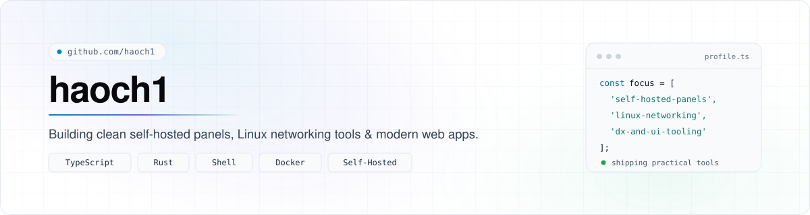

  <a href="https://github.com/haoch1">
    <picture>
      <source media="(prefers-color-scheme: dark)" srcset="./assets/banner-dark.svg" />
      <source media="(prefers-color-scheme: light)" srcset="./assets/banner-light.svg" />
      
    </picture>
  </a>

  

    <strong>简体中文</strong> · <a href="./README.en.md">English</a>
  

  

    专注于 <strong>自托管云管面板</strong>、<strong>Linux 网络工具</strong> 与 <strong>现代全栈应用</strong>。 
    追求克制的界面设计、极简依赖，以及开箱即用的 Docker / 单二进制部署体验。
  

  

    
    
    
  

---

### 精选项目

<table>
  <tr>
    <td width="50%" valign="top">
      <a href="https://github.com/haoch1/CloudSeed"><strong>CloudSeed</strong></a> 
      自托管 Cloudflare DNS 与 R2 管理面板，支持多账号与 Docker 一键部署。  
      <code>TypeScript</code> <code>Cloudflare</code> <code>Docker</code>
    </td>
    <td width="50%" valign="top">
      <a href="https://github.com/haoch1/lightsail-panel"><strong>lightsail-panel</strong></a> 
      Amazon Lightsail 自托管控制台，支持多账户跨区域管理、网页 SSH、流量图表与阈值自动关机。  
      <code>JavaScript</code> <code>AWS Lightsail</code> <code>Web SSH</code>
    </td>
  </tr>
  <tr>
    <td width="50%" valign="top">
      <a href="https://github.com/haoch1/aliyun-panel"><strong>aliyun-panel</strong></a> 
      阿里云 ECS 自托管面板，支持实例保活、流量阈值保护、定时开关机、账单查询与 Telegram 通知。  
      <code>TypeScript</code> <code>Docker</code> <code>Alibaba Cloud</code>
    </td>
    <td width="50%" valign="top">
      <a href="https://github.com/haoch1/hproxy"><strong>hproxy</strong></a> 
      面向 Linux 服务器的代理节点与端口转发控制台，Docker 主控 + 原生二进制 Agent，集成 sing-box 与 Realm。  
      <code>Rust</code> <code>Docker</code> <code>Linux</code>
    </td>
  </tr>
  <tr>
    <td width="50%" valign="top">
      <a href="https://github.com/haoch1/forme"><strong>forme</strong></a> 
      面向中文用户的 shadcn/ui 选配工作台，提供中文预设、实时组件预览、主题定制与独立项目模板。  
      <code>React</code> <code>TypeScript</code> <code>Vite</code> <code>Tailwind</code>
    </td>
    <td width="50%" valign="top">
      <a href="https://github.com/haoch1/SeekFeed"><strong>SeekFeed</strong></a> 
      面向 NodeSeek 社区的自托管监控与分析平台，支持 RSS 采集、热榜、关键词订阅与 Telegram 通知。  
      <code>Bun</code> <code>Hono</code> <code>SQLite</code> <code>TypeScript</code>
    </td>
  </tr>
</table>

---

### 最近更新

由 GitHub Actions 每日自动同步最新原创仓库

<!-- RECENT_PROJECTS:START -->
- [**singbox**](https://github.com/haoch1/singbox) · `Shell` · 2026/11/22 Linux sing-box 节点管理脚本，支持 Vless、Shadowsocks 2022、AnyTLS、Hysteria2、Snell 和端口跳跃，提供服务控制与核心更新
- [**SeekFeed**](https://github.com/haoch1/SeekFeed) · `TypeScript` · 2026/11/21 面向 NodeSeek 社区的轻量级自托管监控与分析平台，提供 RSS 实时采集、关键词订阅、Telegram 通知与多维统计分析，基于 Bun、Hono 与 SQLite。
- [**CloudSeed**](https://github.com/haoch1/CloudSeed) · `TypeScript` · 2026/11/21 轻量自托管 Cloudflare DNS 与 R2 对象存储管理面板，基于官方 Kumo 设计系统，支持多账号、浏览器直传预览与 Docker 部署
- [**aliyun-panel**](https://github.com/haoch1/aliyun-panel) · `JavaScript` · 2026/11/21 阿里云 ECS 自托管中文管理面板，支持实例自动保活、共享流量阈值保护、每日定时开关机、账单与余额查询及 Telegram 通知，极简黑白设计，适配桌面与移动端，提供 amd64/arm64 Docker 镜像。
- [**lightsail-panel**](https://github.com/haoch1/lightsail-panel) · `JavaScript` · 2026/11/21 Amazon Lightsail 自托管中文管理面板，支持多账户跨区域实例管理、网页 SSH 终端、静态 IP 与防火墙、按日流量图表、阈值自动关机及 Telegram 通知，极简黑白设计，适配桌面与移动端。
- [**realm**](https://github.com/haoch1/realm) · `Shell` · 2026/11/12 Linux Realm TCP/UDP 端口转发管理脚本，支持规则管理、服务控制与核心更新
<!-- RECENT_PROJECTS:END -->

---

### 技术栈

  <picture>
    <source media="(prefers-color-scheme: dark)" srcset="https://skillicons.dev/icons?i=ts%2Cjs%2Crust%2Cbash%2Creact%2Cvite%2Ctailwind%2Cbun%2Cnodejs%2Csqlite%2Cdocker%2Clinux%2Ccloudflare&theme=dark" />
    <source media="(prefers-color-scheme: light)" srcset="https://skillicons.dev/icons?i=ts%2Cjs%2Crust%2Cbash%2Creact%2Cvite%2Ctailwind%2Cbun%2Cnodejs%2Csqlite%2Cdocker%2Clinux%2Ccloudflare&theme=light" />
    
  </picture>

---

  <picture>
    <source media="(prefers-color-scheme: dark)" srcset="https://raw.githubusercontent.com/haoch1/haoch1/output/snake-dark.svg" />
    <source media="(prefers-color-scheme: light)" srcset="https://raw.githubusercontent.com/haoch1/haoch1/output/snake-light.svg" />
    
  </picture>

   
  感谢来访 · 欢迎通过 Issue / PR 交流想法

